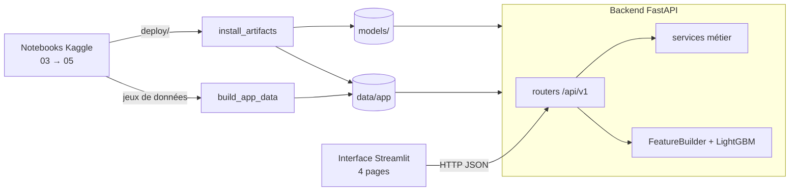

# 🛒 E-Commerce Intelligence Platform

> **Plateforme de data science de bout en bout sur la marketplace brésilienne Olist** : une **API FastAPI** qui sert trois modèles (durée de livraison, risque de retard, segmentation clients) et un **tableau de bord Streamlit** qui la consomme.
> *End-to-end data science platform on the Olist Brazilian marketplace: a FastAPI backend serving three models (delivery time, late-delivery risk, customer segmentation) and a Streamlit dashboard consuming it.*


<!-- Ajouter ici les captures : docs/images/kpi.png, modele1.png, modele2.png, modele3.png, api-docs.png -->

## Le problème

Sur une marketplace, la livraison est assurée par des vendeurs indépendants sur un territoire immense : une livraison tardive ou mal annoncée dégrade la satisfaction et la fidélité.
Le projet répond à trois questions métier, avec une **méthodologie CRISP-DM** complète (6 phases) :

| # | Question | Modèle | Page de l'application | Routes de l'API |
|---|---|---|---|---|
| 1 | Combien de temps durera la livraison, et quelle promesse afficher ? | Régression (LightGBM, quantiles) | 🚚 Durée de livraison | `/api/v1/delivery/*` |
| 2 | Quelles commandes risquent d'arriver en retard ? | Score de risque (écart durée prédite − promesse) | ⚠️ Risque de retard | `/api/v1/risk/*` |
| 3 | Quels clients, quelle expérience, quelle action ? | Clustering (K-Means) + grille de valeur | 👥 Segments clients | `/api/v1/segments/*` |

Une première page (📊 **KPI**, routes `/api/v1/kpi/*`) donne la vue d'ensemble : volumes, chiffre d'affaires, retards par état, satisfaction.

## Résultats clés

*Données Olist (2017 à août 2018), évaluation **temporelle glissante** : chaque mois est prédit par un modèle entraîné uniquement sur les mois précédents (mars à août 2018).*

| Sujet | Résultat |
|---|---|
| **Durée de livraison** | Erreur moyenne de **4,3 jours**, soit **−65 %** contre la promesse d'Olist (12,2 j) et **−13 %** contre la meilleure baseline (médiane par état des 3 derniers mois : 4,9 j) |
| **Promesse par quantile** | Le quantile 0,90 propose une promesse **plus courte (20,0 j contre 21,9 j) avec moins de retards (7,3 % contre 8,8 %)** ; le quantile 0,95 **divise le taux de retard par 2** (4,1 %) |
| **Risque de retard** | Les 10 % de commandes les plus risquées contiennent **21,6 % de retards (3,5 fois le taux de base)** et capturent **35 % des retards** ; ROC-AUC de 0,775 sur le test |
| **Rentabilité des alertes** | Positive dès que le coût d'un retard manqué atteint 3 à 5 fois celui d'une fausse alerte (hypothèses modifiables dans l'application) |
| **Segments clients** | 3 segments d'expérience stables : satisfaits (78 %), insatisfaits avec livraison normale (16 %), insatisfaits par la livraison (6 %) ; **4 518 clients de valeur élevée insatisfaits** à traiter en priorité |

### Honnêteté méthodologique

- Le gain contre une simple médiane par état reste **modeste (0,5 à 0,6 jour)** : une grande part du signal est géographique.
- Hypothèse testée et **réfutée** : les variables proxys du temps ne sont pas la cause de la dérive du classifieur.
- Un classifieur direct « retard / pas de retard » s'est révélé **instable** ; la régression de l'écart durée − promesse est plus robuste.
- Coûts d'alerte et effet d'une promesse plus courte sur les ventes : **hypothèses**, non mesurées.

## Architecture



- **Backend** : API REST versionnée (FastAPI, Pydantic v2), validation des entrées, erreurs explicites (`401`, `404`, `422`, `503`), clé d'API optionnelle, CORS, cache des artefacts, schéma OpenAPI versionné ([`docs/openapi.json`](docs/openapi.json)).
- **Frontend** : Streamlit, **sans aucun import du backend** (vérifié par un test) : il n'appelle que l'API par HTTP.
- **Deux modes d'exécution, un seul code** : API distante (`ECI_API_URL`) ou API intégrée (démarrée dans un thread local pour un déploiement en un seul processus).

Détails : [docs/ARCHITECTURE.md](docs/ARCHITECTURE.md) · [docs/API.md](docs/API.md).

## Démarrage rapide (jeu de démonstration)

```bash
git clone https://github.com/<votre-compte>/ecommerce-intelligence-platform.git
cd ecommerce-intelligence-platform
python -m venv .venv && source .venv/bin/activate
make install

make run            # un seul processus : http://localhost:8501

# ou, architecture cible en deux processus :
make api            # API : http://localhost:8000/docs
make run-remote     # interface connectée à l'API
```

Ou avec Docker : `make docker-up` (API sur le port 8000, interface sur le port 8501).

L'application démarre avec un **jeu synthétique** (bandeau « Mode démonstration »). Pour afficher les vrais résultats : [docs/DEPLOYMENT.md](docs/DEPLOYMENT.md).

## Exemple d'appel à l'API

```bash
curl -X POST http://localhost:8000/api/v1/delivery/predict -H "Content-Type: application/json" -d '{
  "customer_state": "RJ", "seller_state": "SP", "total_price": 120, "total_freight": 25,
  "total_weight_g": 1500, "total_volume_cm3": 8000, "promised_days": 24 }'
```

## Les pages de l'application

| Page | Ce qu'on y fait |
|---|---|
| 📊 **KPI** | Filtrer par période et par état ; indicateurs avec variation vs période précédente ; tendances, carte du Brésil, délais, satisfaction ; constats automatiques |
| 🚚 **Modèle 1** | Choisir un niveau de prudence de promesse et voir le compromis durée / retards ; **estimer une commande** (formulaire → `POST /delivery/predict`) ; performance et baselines |
| ⚠️ **Modèle 2** | Régler capacité, coût d'un retard et efficacité des alertes pour voir le **bénéfice net** ; liste des commandes à surveiller (CSV) ; fiabilité mensuelle ; **évaluer une commande** |
| 👥 **Modèle 3** | Segments et profils ; **grille d'actions** expérience × valeur ; ciblage avec export CSV ; recherche d'un client ; méthodologie |

## Arborescence

```
ecommerce-intelligence-platform/
├── .github/
│   └── workflows/   # CI GitHub Actions
│       └── ci.yml
├── .streamlit/
│   └── config.toml
├── app/   # Frontend Streamlit (client HTTP de l'API)
│   ├── ui/   # Client HTTP, graphiques Plotly, formulaires, thème
│   │   ├── api.py
│   │   ├── api_client.py
│   │   ├── charts.py
│   │   ├── embedded.py
│   │   ├── format.py
│   │   ├── forms.py
│   │   └── style.py
│   ├── views/   # 4 pages : kpi, model1, model2, model3
│   │   ├── kpi.py
│   │   ├── model1.py
│   │   ├── model2.py
│   │   └── model3.py
│   └── streamlit_app.py
├── data/
│   ├── app/   # Tables de l'application (versionnées)
│   ├── demo/   # Jeu synthétique (démarrage immédiat)
│   ├── processed/   # Jeux de modélisation (non versionnés)
│   ├── raw/   # CSV Olist (non versionnés)
│   └── README.md
├── docs/   # Architecture, API, données, déploiement, openapi.json
│   ├── images/
│   ├── API.md
│   ├── ARCHITECTURE.md
│   ├── DATA.md
│   ├── DEPLOYMENT.md
│   └── openapi.json
├── models/
│   └── README.md
├── notebooks/   # Notebooks Kaggle 02 → 05c
│   ├── 02_data_understanding_eda.ipynb
│   ├── 03_data_preparation.ipynb
│   ├── 04a_model1_delivery_duration.ipynb
│   ├── 04b_model2_late_risk.ipynb
│   ├── 04c_model3_customer_segmentation.ipynb
│   ├── 05a_model1_corrections_final.ipynb
│   ├── 05b_model2_corrections_final.ipynb
│   ├── 05c_model3_segmentation_final.ipynb
│   └── README.md
├── reports/   # Exports PDF des rapports
│   └── README.md
├── scripts/   # export_openapi.py
│   └── export_openapi.py
├── src/   # Backend (package Python)
│   └── ecommerce_intel/
│       ├── api/   # API FastAPI : main, schémas, serializers, deps, cache
│       │   ├── routers/   # health, kpi, delivery, risk, segments
│       │   │   ├── delivery.py
│       │   │   ├── health.py
│       │   │   ├── kpi.py
│       │   │   ├── risk.py
│       │   │   └── segments.py
│       │   ├── deps.py
│       │   ├── main.py
│       │   ├── schemas.py
│       │   ├── serializers.py
│       │   └── store.py
│       ├── data/   # Chargeurs d'artefacts
│       │   └── loaders.py
│       ├── models/   # FeatureBuilder, prédicteurs LightGBM
│       │   ├── feature_builder.py
│       │   └── predictors.py
│       ├── pipeline/   # build_app_data, install_artifacts
│       │   ├── build_app_data.py
│       │   └── install_artifacts.py
│       ├── services/   # Logique métier pure (testée sans HTTP)
│       │   ├── delivery_service.py
│       │   ├── kpi_service.py
│       │   ├── risk_service.py
│       │   └── segmentation_service.py
│       ├── utils/   # Formats, géographie
│       │   ├── formatting.py
│       │   └── geo.py
│       └── config.py
├── tests/   # Tests : services, modèles, pipeline, API, interface
│   ├── conftest.py
│   ├── test_api.py
│   ├── test_app_smoke.py
│   ├── test_models.py
│   ├── test_pipeline.py
│   └── test_services.py
├── .dockerignore
├── .gitignore
├── docker-compose.yml
├── Dockerfile.api
├── Dockerfile.app
├── LICENSE
├── Makefile
├── pyproject.toml
├── README.md
├── requirements-api.txt
├── requirements-app.txt
├── requirements-dev.txt
└── requirements.txt
```

## Méthodologie CRISP-DM

| Phase | Livrables dans ce dépôt |
|---|---|
| 1. Business Understanding | Contexte, problématique, objectifs (`reports/`) |
| 2. Data Understanding | `notebooks/02_*`, rapport de qualité et d'analyse exploratoire |
| 3. Data Preparation | `notebooks/03_*` : 3 jeux de données, historique vendeur et trajet **sans fuite de données**, découpage temporel |
| 4. Modeling | `notebooks/04a/b/c_*` : **24 modèles de régression, 17 de classification, 16 algorithmes de clustering** comparés |
| 5. Evaluation | `notebooks/05a/b/c_*` : évaluation glissante, baselines équitables, ablations, rentabilité |
| 6. Deployment | `src/` (API FastAPI) et `app/` (Streamlit) : tests, CI, Docker Compose |

## Choix techniques

- **Aucune fuite de données** : toutes les variables sont connues à l'achat ; l'historique du vendeur et du trajet n'utilise que des livraisons terminées avant l'achat.
- **Évaluation temporelle glissante** plutôt qu'un seul test : elle montre la dérive (livraisons de plus en plus rapides en 2018).
- **Contrat d'API d'abord** : schémas Pydantic, bornes de validation, erreurs au format uniforme, OpenAPI exporté et vérifié en CI.
- **Séparation interface / API / métier** : les services (`src/…/services`) se testent sans HTTP ; l'interface se déploie dans une image sans données ni modèles.
- **Backend d'inférence** : un `FeatureBuilder` transforme une saisie d'une douzaine de champs en ~37 variables (distance de Haversine, historique du trajet, valeurs typiques).
- **Qualité** : 54 tests (services, modèles, pipeline, API HTTP avec cas d'erreur et d'authentification, pages Streamlit avec `streamlit.testing`), CI GitHub Actions, `ruff`.

## Qualité et tests

```bash
make install-dev
make test       # 54 tests sur le jeu de démonstration
make lint
make openapi    # régénère docs/openapi.json
```

## Limites

Période d'évaluation courte (6 mois) ; pas de données sur le transporteur, la météo ou les incidents ; 97 % de clients à achat unique (la segmentation décrit des profils d'expérience, pas une fidélité) ;
coûts et efficacité des alertes non mesurés sur des données réelles.

## Données et licence

Données : *Brazilian E-Commerce Public Dataset by Olist* (Kaggle, licence CC BY-NC-SA 4.0 : usage non commercial). Code : licence MIT.

## Auteur

*Votre nom* · [LinkedIn](https://www.linkedin.com/) · [Portfolio](https://github.com/)
