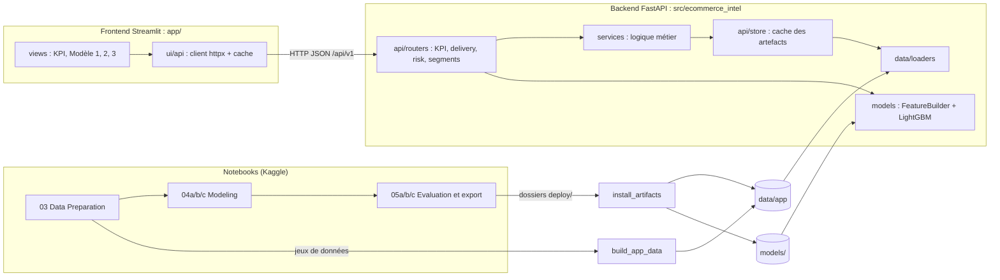

# Architecture

## Vue d'ensemble

## Couches

| Couche | Dossier | Rôle |
|---|---|---|
| Interface | `app/` | Pages Streamlit, graphiques Plotly, formulaires. **Aucune logique métier ni import du backend** : elle n'appelle que l'API. |
| API | `src/ecommerce_intel/api/` | Application FastAPI : routes versionnées `/api/v1`, schémas Pydantic, validation, erreurs, authentification optionnelle, cache. |
| Services | `src/ecommerce_intel/services/` | Calculs métier purs (KPI, promesse, rentabilité des alertes, segments). Testés sans HTTP. |
| Modèles | `src/ecommerce_intel/models/` | `FeatureBuilder` (saisie → ~37 variables) et prédicteurs LightGBM. |
| Données | `src/ecommerce_intel/data/` | Chargement des artefacts, messages d'erreur explicites. |
| Pipeline | `src/ecommerce_intel/pipeline/` | `build_app_data` (agrégats) et `install_artifacts` (copie des sorties de notebooks). |

## Principes de conception

- **Contrat d'API explicite** : le schéma OpenAPI est généré (`docs/openapi.json`, vérifié en CI) ; les clés JSON sont en anglais (snake_case), l'interface traduit à l'affichage.
- **Séparation interface / API / métier** : l'interface se déploie séparément (image Docker sans données ni modèles) ; les services se testent sans HTTP.
- **Deux modes d'exécution, un seul code** : API distante (`ECI_API_URL`) ou API intégrée (démarrée dans un thread du processus Streamlit, sur un port local). Dans les deux cas, le frontend passe par HTTP.
- **Application légère** : l'API lit de petites tables pré-calculées, pas les 96 000 commandes brutes.
- **Mode démonstration** : sans `data/app`, l'API bascule sur `data/demo` (synthétique) et le signale dans `/health` et dans l'interface.
- **Pas de fuite de données** : toutes les évaluations viennent d'une validation temporelle glissante (notebooks 05a/05b).
- **Dégradation maîtrisée** : un artefact manquant renvoie `503` avec un message explicite, sans empêcher le reste de l'API de répondre.
- **Sécurité minimale** : clé d'API optionnelle (`X-API-Key`, comparaison en temps constant), CORS configurable, validation stricte des entrées (bornes, états connus).
